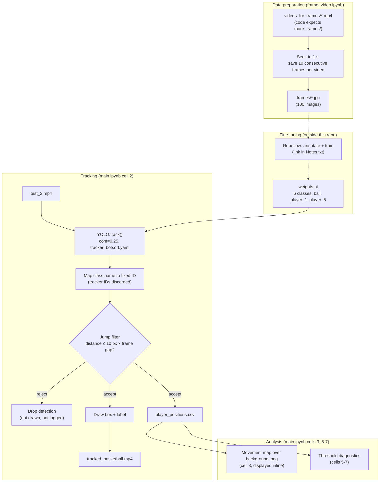

# Architecture

This document explains how the pipeline turns a basketball play-diagram video into tracked positions, an annotated video, and a movement map. It covers each stage in the order data flows through it, then lists every parameter and magic number in the code, then compares what the code does with what the proposal planned.

All file and cell references point to `Final_Project_Computer_Vision/`. Cell numbers are zero-based, matching the order in the `.ipynb` JSON.

## What the input looks like

The pipeline targets **animated play diagrams**, not real game footage. Each video is a portrait 720 × 1280 clip at 60 fps showing a top-down half-court with five orange numbers (`1`–`5`) for offensive players and a small basketball icon that moves between them (see any image in `frames/`). The source is the "Basketball play diagram" YouTube playlist in `Notes.txt`.

This choice follows the instructor feedback recorded in `Notes.txt`: "stay on the simple video first and go from there." Because the camera never moves and each player is a fixed digit, the model can treat each player as its **own class**, which is the key design decision behind the tracking stage.

## Pipeline overview



Solid arrows run in the notebooks. Dotted arrows happened manually outside this repository.

## Stage 1: Frame extraction (`frame_video.ipynb`, cell 0)

The notebook builds a small image set for annotation.

1. Create `output_folder` (`"frames"`) with `os.makedirs(..., exist_ok=True)`.
2. Collect `glob.glob(os.path.join(input_folder, "*.mp4"))` and process the list in sorted order.
3. For each video:
   - Open it with `cv2.VideoCapture`. Skip it with a message if it does not open or if `CAP_PROP_FPS <= 0`.
   - Compute `start_frame = int(start_time_sec * fps)` and seek with `cap.set(cv2.CAP_PROP_POS_FRAMES, start_frame)`.
   - Read and save frames until `frames_per_video` are written or the video ends.
   - Name each file `f"{base_name}_frame_{saved:02d}.jpg"`.

The saved frames are **consecutive** (at 60 fps, 10 frames span about 0.17 s), so the 10 images from one video are nearly identical. The saved output shows the cell last ran against `more_frames/fine_tune_*.mp4`.

## Stage 2: Model and fine-tuning

`main.ipynb` loads the model with:

```python
model = YOLO("weights.pt")
```

The saved output of cell 1 confirms the class map:

| Class ID | Class name |
|---|---|
| 0 | `ball` |
| 1 | `player_1` |
| 2 | `player_2` |
| 3 | `player_3` |
| 4 | `player_4` |
| 5 | `player_5` |

**What the repository does and does not show about training:**

- Fine-tuning ran on Roboflow. `Notes.txt` links to a Roboflow model whose URL contains `basketball-diagram-digits-and-ba` and `yolo26s`, which suggests a YOLO26-small base model. The code itself never states the architecture.
- There is no training script, dataset YAML, annotation export, or training metrics in the repository. You cannot reproduce `weights.pt` from this codebase.
- The 100 frames in `frames/` are the likely training images, but no file links them to the Roboflow dataset.

## Stage 3: Detection and tracking (`main.ipynb`, cell 2)

### Video setup

The cell opens `video_path` once to read `fps`, `width`, `height`, and `total_frames`, then releases it. It raises `RuntimeError` if the video does not open and `ValueError` if `fps <= 0`. It creates the output writer:

```python
writer_video = cv2.VideoWriter(
    output_path,
    cv2.VideoWriter_fourcc(*"mp4v"),
    fps,
    (width, height)
)
```

The output keeps the input's frame rate and resolution.

### Running the tracker

```python
results = model.track(
    source=video_path,
    stream=True,
    persist=True,
    tracker="botsort.yaml",
    conf=CONFIDENCE,
    verbose=False
)
```

- `stream=True` yields one `Results` object per frame instead of loading the whole video into memory.
- `persist=True` keeps tracker state between frames.
- `tracker="botsort.yaml"` selects the BoT-SORT configuration that ships with Ultralytics. The repository has no custom tracker YAML.
- `conf=0.25` discards detections below 25% confidence.

The loop enumerates the results, so `frame_number` is the zero-based index of the yielded frame. For each frame it copies `result.orig_img`, reads `boxes.xywh` (center x, center y, width, height in pixels), `boxes.cls`, and `boxes.conf`.

### Identity comes from the class, not the tracker

```python
track_id = CLASS_IDS[class_name]
```

The code **ignores the tracker's own IDs** (`boxes.id` is never read). Instead, each object's `track_id` is fixed by its class: `ball` is always `0`, `player_3` is always `3`, and so on. This works because every player in the diagram is a distinct digit the detector can classify directly. BoT-SORT still runs, so Ultralytics only returns the boxes the tracker keeps, but the tracker's association does not determine identity.

Consequences:

- An identity switch can only happen if the detector misclassifies a digit.
- The pipeline assumes **at most one instance of each class**. It cannot handle two teams, defenders, or duplicate numbers.
- Detections whose class name is not in `CLASS_IDS` are skipped. With the current six-class model, this never triggers.

### Jump filter

The jump filter rejects detections that move implausibly far from the last accepted position of the same class. State lives in `last_positions`, a dict of `class_name -> (x, y, frame_number)`.

```python
frame_gap = frame_number - prev_frame
allowed_distance = JUMP_THRESHOLD * frame_gap
distance = math.hypot(x - prev_x, y - prev_y)
if distance > allowed_distance:
    continue
```

Behavior to understand before you tune it:

- **First detection is always accepted.** If the first detection of a class is wrong, later correct detections are rejected until the allowance (`10 px × frames elapsed`) grows large enough to reach them.
- **The allowance grows with time.** After a gap of `n` frames, the object may move up to `10 × n` px. At 60 fps that is 600 px per second.
- **One detection per class per frame.** After a class is accepted in frame `n`, a second detection of the same class in the same frame has `frame_gap = 0`, so `allowed_distance = 0`. It is rejected unless it sits at exactly the same point. Whichever box Ultralytics returns first wins.
- **Rejected detections vanish.** They are neither drawn on the video nor written to the CSV, and they do not update `last_positions`.

The threshold `10.0` was chosen from the diagnostics in cells 5–7 (see [Stage 5](#stage-5-threshold-diagnostics-mainipynb-cells-57)).

### Drawing

For each accepted detection the cell converts center/size to corners, then draws:

- a 2 px rectangle in **red `(0, 0, 255)` BGR for `ball`**, **green `(0, 255, 0)` BGR for every player**
- a label `f"{class_name} ID:{track_id}"` with `cv2.FONT_HERSHEY_SIMPLEX`, scale `0.6`, thickness `2`, anti-aliased, placed 8 px above the box and never higher than `y = 20`

Every frame is written to the output video whether or not it has detections.

### CSV export

Each accepted detection becomes one row:

```python
writer_csv.writerow([
    frame_number,
    round(frame_number / fps, 3),
    class_name,
    track_id,
    round(x, 2),
    round(y, 2),
    round(float(confidence), 3)
])
```

`x` and `y` are the **bounding-box center** in image pixels. See [DATA.md](DATA.md#player_positionscsv) for the full schema.

The video writer is released in a `finally` block, so a crash mid-loop still closes the file.

## Stage 4: Movement map (`main.ipynb`, cell 3)

The cell visualizes the CSV as paths drawn on an empty court.

1. Load `player_positions.csv` with pandas.
2. Open `test_2.mp4` only to read its width and height.
3. Load `background.jpeg` (1080 × 1920), resize it to the video size (720 × 1280) with `cv2.INTER_AREA`, and convert BGR to RGB.
4. Drop rows missing `class`, `track_id`, `x`, `y`, or `frame`; cast `track_id` to `int`; keep only the six known classes.
5. Plot on a `figsize=(14, 8)` figure. The background uses `extent=[0, video_width, video_height, 0]`, so pixel coordinates from the CSV line up with the image directly. **No homography or court-coordinate conversion happens**; the "court mapping" is pixel-for-pixel overlay on a matching image.
6. For each `(class, track_id)` group, sorted by frame:
   - path line: width 2, alpha 0.85
   - start marker: circle `"o"`, size 65, black edge
   - end marker: `"X"`, size 75, black edge
   - up to 5 direction arrows (`"->"`, width 1.2), only if the path has at least 8 points, spaced with `np.linspace(1, len(x) - 2, min(5, len(x) - 2), dtype=int)`
7. Add a legend outside the plot (`bbox_to_anchor=(1.02, 1)`) with labels like `player_1 — ID 1`, invert the y-axis to match image coordinates, and call `plt.show()`.

The figure is only **displayed**; the code never saves it to a file.

Colors per class:

| Class | Hex |
|---|---|
| `ball` | `#ff3b30` (red) |
| `player_1` | `#007aff` (blue) |
| `player_2` | `#34c759` (green) |
| `player_3` | `#af52de` (purple) |
| `player_4` | `#ff9500` (orange) |
| `player_5` | `#00a6a6` (teal) |

The saved output reports 6,335 plotted detections, which matches the row count of the current `player_positions.csv`.

## Stage 5: Threshold diagnostics (`main.ipynb`, cells 5–7)

A markdown cell (cell 4) labels this section "IGNORE THIS - I WAS CHECKING SOMETINHG WITH THE THRESHOLD". The cells still run and read the current CSV.

| Cell | Object analyzed | What it computes | Output |
|---|---|---|---|
| 5 | `player_2` | Distance between consecutive detections where `frame_gap == 1`; prints the 10 largest jumps and plots the single largest (displacement vector + zoomed positions) | table + 2-panel figure |
| 6 | `player_1` | `dt`, `dx`, `dy`, Euclidean `distance`, `speed = distance / dt` (pixels per second), `frame_gap`; non-consecutive steps set to NaN; flags the top 5% of jumps (`quantile(0.95)`) as `big_jump` | 3-panel figure (position, speed, jumps) + printed summary |
| 7 | `player_1`, `player_2` | 50th, 90th, 95th, 99th percentile and max of consecutive-frame movement | printed table |

Cell 6 prints the explicit caveat: speed is measured in image pixels, not meters per second.

> **Stale outputs.** The saved outputs of cells 5–7 were produced from a different version of `player_positions.csv` than the one in the repository:
>
> | Saved output | Current CSV |
> |---|---|
> | `player_2` max consecutive-frame jump 488.9 px (cells 5, 7) | about 3.2 px |
> | `player_1` max consecutive-frame jump 9.50 px (cells 6, 7) | about 5.5 px |
> | `player_1` detections: 1121 (cell 6) | 1120 |
>
> The 488.9 px jumps are well above the 10 px filter, so those outputs most likely came from a run before the filter existed and show why `JUMP_THRESHOLD` was added. Treat them as history, not current results; re-run the cells to regenerate them.

## Parameters and magic numbers

| Name / value | Location | Meaning |
|---|---|---|
| `input_folder = "more_frames"` | `frame_video.ipynb` | Source video folder. Does not exist in the repo; videos are in `videos_for_frames/` |
| `output_folder = "frames"` | `frame_video.ipynb` | JPEG output folder |
| `start_time_sec = 1` | `frame_video.ipynb` | Skip the first second of each video |
| `frames_per_video = 10` | `frame_video.ipynb` | Consecutive frames saved per video |
| `"weights.pt"` | `main.ipynb` cells 1, 2 | Fine-tuned YOLO weights, loaded twice |
| `video_path = "test_2.mp4"` | cell 2 | Input video (also hard-coded separately in cell 3) |
| `output_path = "tracked_basketball.mp4"` | cell 2 | Annotated output video |
| `csv_path = "player_positions.csv"` | cell 2 | Position log (also hard-coded in cells 3, 5, 6, 7) |
| `CONFIDENCE = 0.25` | cell 2 | Minimum detection confidence passed to `model.track` |
| `JUMP_THRESHOLD = 10.0` | cell 2 | Max movement in pixels per elapsed frame |
| `CLASS_IDS` | cell 2 | `ball: 0`, `player_1`–`player_5: 1`–`5`; used as fixed `track_id` |
| `"botsort.yaml"` | cell 2 | Ultralytics built-in BoT-SORT config |
| `"mp4v"` | cell 2 | Output video FourCC |
| `(0, 0, 255)` / `(0, 255, 0)` | cell 2 | BGR box color for ball / players |
| `0.6`, `2`, `8`, `20` | cell 2 | Label font scale, line thickness, label offset above box, minimum label y |
| Rounding `3`, `2`, `2`, `3` | cell 2 | Decimal places for `time_seconds`, `x`, `y`, `confidence` |
| `cv2.INTER_AREA` | cell 3 | Interpolation used to resize `background.jpeg` |
| `figsize=(14, 8)` | cell 3 | Movement map size |
| `8`, `5` | cell 3 | Minimum points before arrows are drawn; maximum arrows per path |
| Hex colors | cell 3 | See [Stage 4](#stage-4-movement-map-mainipynb-cell-3) |
| `0.95` | cell 6 | Quantile used to flag "big jumps" |
| `frame_gap == 1` | cells 5, 6, 7 | Only consecutive-frame steps count in jump statistics |

Values that come from the data rather than the code: the test video runs at 60 fps (inferred from `time_seconds` stepping by 0.017 and from frame 1119 at 18.65 s), is 720 × 1280 (cell 3 output), and has 1,120 frames (cell 2 progress bar).

## Planned vs. implemented

The proposal and slides describe a three-stage system (perception, event understanding, play retrieval) for real single-camera game video. The code implements a narrow slice of Stage A on animated diagrams. Use this table to tell which is which.

| Proposal item | Status in code |
|---|---|
| Fine-tuned YOLO detector | **Implemented, differently.** Six classes (`ball`, `player_1`–`player_5`) on play diagrams, trained on Roboflow. The proposal planned YOLOv8 with `player`, `referee`, `ball` on game footage. No training code in repo |
| TrackNet-style multi-frame ball heatmap detector | Not implemented |
| Kalman filter, gap interpolation for the ball | Not implemented. Missing detections stay missing (the ball has 735 rows vs. 1,120 per player) |
| Rejecting physically implausible jumps | **Implemented** as the fixed-threshold jump filter |
| Tracker benchmark (DeepSORT vs. ByteTrack vs. BoT-SORT) with HOTA/IDF1 | Not implemented. Only BoT-SORT runs, and its IDs are discarded in favor of class-based IDs |
| Track stitching | Not implemented (not needed with class-based IDs) |
| Court keypoint detection + RANSAC homography to feet | Not implemented. Positions stay in image pixels; the movement map overlays pixels on a same-size court image |
| Team assignment (HSV + k-means) | Not implemented. Diagrams show only one team |
| HMM ball possession | Not implemented. `Notes.txt` feedback suggests ball–player distance as a first step; no code computes it yet |
| Pass / turnover detection, play segmentation | Not implemented |
| Court zones (corner, wing, top) | Not implemented (suggested in `Notes.txt` feedback) |
| Role alignment, play descriptors, DTW / contrastive retrieval | Not implemented |
| Evaluation metrics (mAP, HOTA, IDF1, event F1, retrieval mAP) | Not implemented. No metrics are computed or saved anywhere in the repo |
| Saving positions to a file for later prediction | **Implemented** as `player_positions.csv` (requested in `Notes.txt` feedback) |
| Movement visualization | **Implemented** (movement map, per-player speed plots); not in the original proposal |
